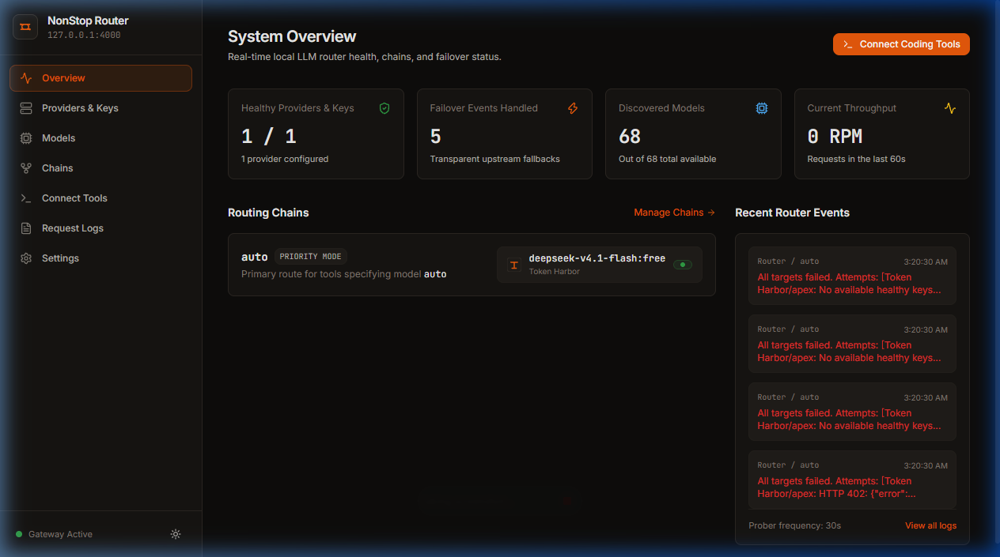
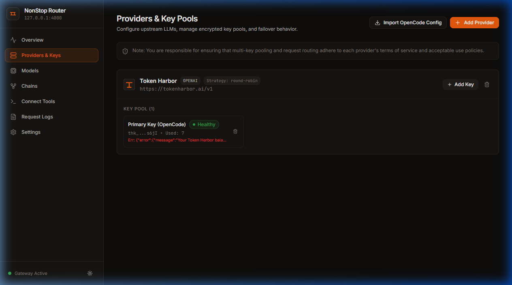
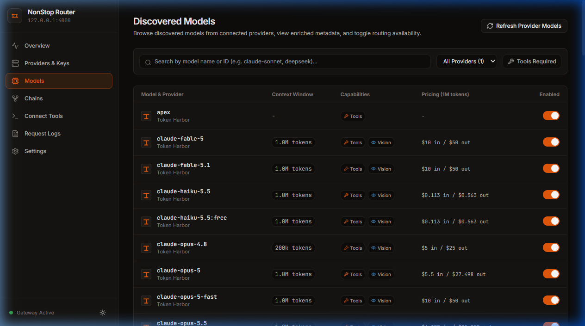
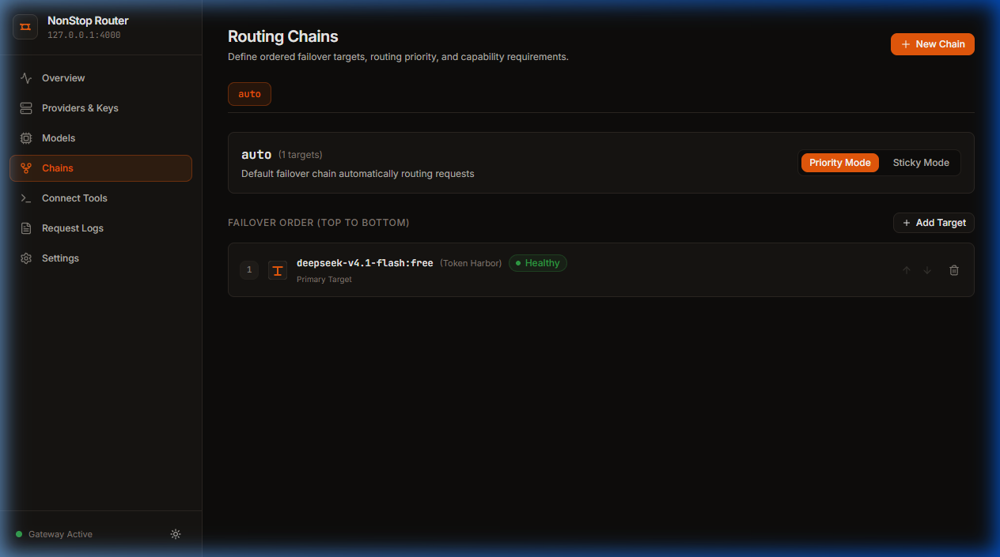
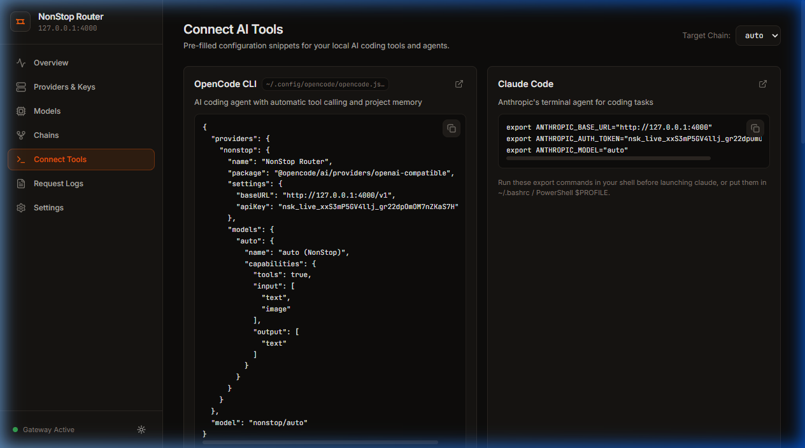
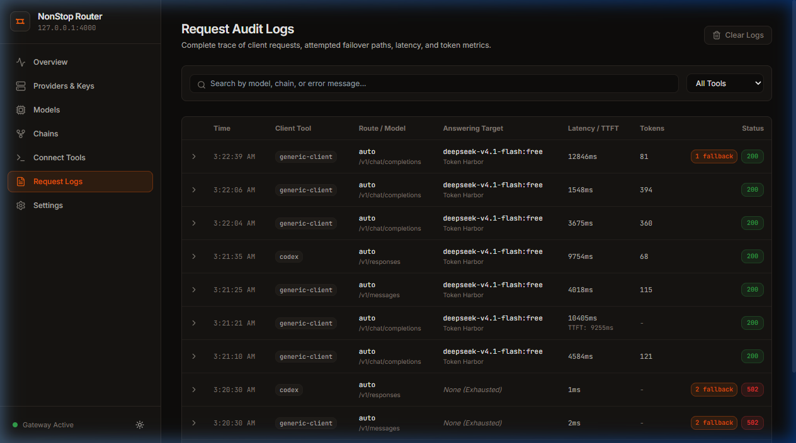
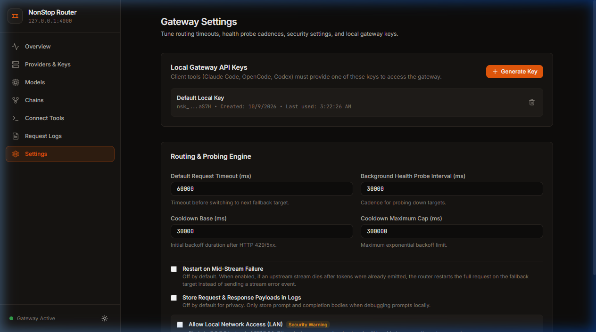
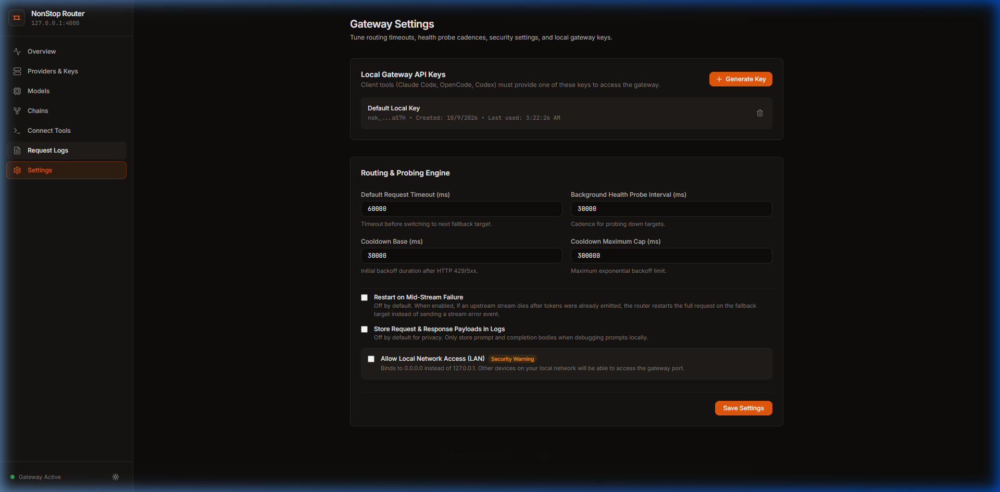
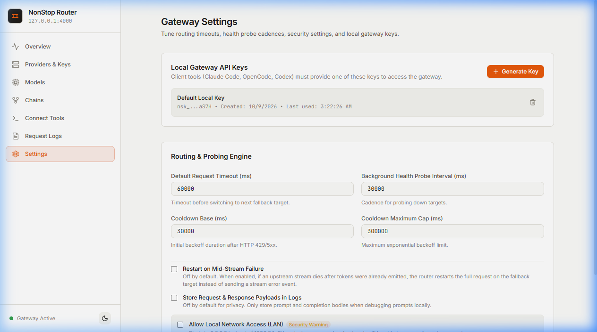

# NonStop Router

NonStop Router is a production-quality, local-first LLM gateway that runs on your local machine. It sits between AI coding tools (OpenCode, Claude Code, Codex CLI, Cline, Roo Code, Continue, Aider, Zed) and multiple LLM providers, automatically executing transparent failover across model targets and API key pools so your workflow never halts.

---

## Key Capabilities

- **Transparent Failover**: Instantly switches to the next healthy key or fallback model upon encountering HTTP 429 rate limits, 5xx outages, 401/403 authorization failures, network timeouts, or stream interruptions before token delivery.
- **Unified Multi-Protocol Gateway**:
  - OpenAI Chat Completions: `/v1/chat/completions` (streaming SSE and non-streaming)
  - Anthropic Messages API: `/v1/messages` (with bidirectional translation for Claude Code)
  - OpenAI Responses API: `/v1/responses` (for Codex CLI)
  - Dynamic Models Catalog: `/v1/models`
- **Key Pooling & Selection Strategies**: Pool multiple keys per provider with configurable selection strategies: Round Robin, Fill-First, or Least-Used.
- **Failover Chain Modes**:
  - **Priority Mode**: Automatically returns to the highest-priority target as soon as it recovers from cooldown.
  - **Sticky Mode**: Latches onto the current functioning target until a failure occurs, maintaining session continuity.
- **Automatic Model Discovery**: Discovers all models returned by provider endpoints (`GET /v1/models`) and enriches entries with context window limits, tool capabilities, vision support, and pricing metadata.
- **Zero-Friction Tool Integration**: Pre-generated configurations for OpenCode, Claude Code, Codex CLI, Cline, Roo Code, Continue, Aider, and Zed. Includes a one-click OpenCode configuration writer with automated backup and diff preview.
- **Local-First Security**: Upstream provider API keys are encrypted at rest using AES-256-GCM. The gateway binds to localhost (`127.0.0.1`) by default.

---

## Screenshots

### System Overview


### Providers & Encrypted Key Pools


### Discovered Models Catalog


### Failover Chains Configuration


### Tool Connection & One-Click OpenCode Integration


### Request Audit Trail


### Settings & Gateway Keys


### Dark and Light Themes



---

## Quickstart

### Prerequisites
- Node.js 20 or higher

### Running via npx
```bash
npx nonstop-router
```

On first launch, NonStop Router starts the gateway on `127.0.0.1:4000` and opens the dashboard in your default browser.

### Running from Source
```bash
git clone https://github.com/skrelectronics/nonstop-router.git
cd nonstop-router
npm install
npm run build
npm start
```

### Docker Deployment
```bash
docker build -t nonstop-router .
docker run -d -p 4000:4000 -v nonstop-data:/root/.nonstop nonstop-router
```

---

## Failover Mechanics

```
Client Request (OpenCode, Claude Code, Codex, Cline)
                 |
                 v
       NonStop Router Gateway (Port 4000)
                 |
                 v
       Chain Resolution (e.g. "auto")
                 |
                 +-----------------------------------------+
                 | Target 1: Primary Model (Key Pool)      |
                 | -> Key 1                                |
                 |    [Failure: 429, 5xx, 401, Timeout]    |
                 | -> Key 2 (Immediate local retry)        |
                 |    [Failure: Cooldown triggered]        |
                 +-----------------------------------------+
                                 |
                                 v
                 +-----------------------------------------+
                 | Target 2: Fallback Model (Key Pool)     |
                 | -> Key 1 -> Success (HTTP 200 OK)       |
                 +-----------------------------------------+
                                 |
                                 v
                 Client receives clean, uninterrupted stream
```

1. **Failure Triggers**:
   - HTTP 429 Too Many Requests
   - HTTP 500, 502, 503, 504 Server Errors
   - HTTP 401 / 403 Authentication Errors
   - Connection timeouts and socket drops
   - Stream failures occurring prior to initial token emission
2. **Fallback Sequence**:
   - Next available healthy key on the active model target.
   - Next configured target model in the chain order.
3. **Recovery & Probing**:
   - Targets respect upstream `Retry-After` and rate-limit reset headers.
   - When headers are absent, exponential backoff is applied (30s, 60s, 120s, up to 300s).
   - An active background worker continuously probes cooling and down targets using minimal test requests, restoring healthy targets automatically.

---

## Tool Setup Instructions

### 1. OpenCode CLI
Use the One-Click writer in the dashboard Connect page, or update `~/.config/opencode/opencode.jsonc`:
```json
{
  "providers": {
    "nonstop": {
      "name": "NonStop Router",
      "package": "@opencode/ai/providers/openai-compatible",
      "settings": {
        "baseURL": "http://127.0.0.1:4000/v1",
        "apiKey": "YOUR_LOCAL_GATEWAY_KEY"
      },
      "models": {
        "auto": {
          "name": "auto (NonStop)",
          "capabilities": {
            "tools": true,
            "input": ["text", "image"],
            "output": ["text"]
          }
        }
      }
    }
  },
  "model": "nonstop/auto"
}
```

### 2. Claude Code
Set the environment variables before starting Claude Code:
```bash
export ANTHROPIC_BASE_URL="http://127.0.0.1:4000"
export ANTHROPIC_AUTH_TOKEN="YOUR_LOCAL_GATEWAY_KEY"
export ANTHROPIC_MODEL="auto"
```

### 3. Codex CLI
```bash
export OPENAI_BASE_URL="http://127.0.0.1:4000/v1"
export OPENAI_API_KEY="YOUR_LOCAL_GATEWAY_KEY"
codex --model auto
```

### 4. Cline & Roo Code (VS Code Extensions)
- Provider: `OpenAI Compatible`
- Base URL: `http://127.0.0.1:4000/v1`
- API Key: `YOUR_LOCAL_GATEWAY_KEY`
- Model ID: `auto`

### 5. Continue
In `~/.continue/config.json`:
```json
{
  "models": [
    {
      "title": "NonStop Router (auto)",
      "provider": "openai",
      "model": "auto",
      "apiKey": "YOUR_LOCAL_GATEWAY_KEY",
      "apiBase": "http://127.0.0.1:4000/v1"
    }
  ]
}
```

### 6. Aider
```bash
export OPENAI_API_BASE="http://127.0.0.1:4000/v1"
export OPENAI_API_KEY="YOUR_LOCAL_GATEWAY_KEY"
aider --model openai/auto
```

### 7. Zed
In `~/.config/zed/settings.json`:
```json
{
  "language_models": {
    "openai": {
      "version": "1",
      "api_url": "http://127.0.0.1:4000/v1",
      "available_models": [
        {
          "name": "auto",
          "display_name": "NonStop Router (auto)",
          "max_tokens": 128000
        }
      ]
    }
  }
}
```

---

## Security Architecture

- **Encrypted Storage**: Upstream provider API keys are encrypted at rest using AES-256-GCM with authenticated tags. The 256-bit master key is stored locally with restricted permissions (`0600`) at `~/.nonstop/master.key`.
- **Key Masking**: Upstream keys and local gateway keys are masked across all UI views and API responses (`sk-...1234`).
- **Localhost Default**: Binds to `127.0.0.1`. Remote network access requires explicitly enabling the LAN setting in the dashboard.
- **Database Durability**: SQLite in WAL mode with normalized transactions (`better-sqlite3`).

---

## License

MIT License. Free and open source.
